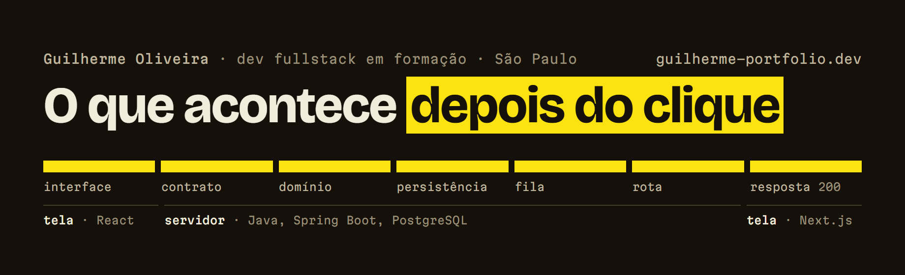

 

## Sobre

Sou desenvolvedor fullstack em formação, em São Paulo. Java e Spring Boot no servidor, React, Next.js
e TypeScript na tela.

Vim do design. Trabalho com UX/UI no time de CRO da Lojas Marisa: página de produto, checkout e
landing pages decididos pelo comportamento da cliente. Toda mudança na tela vira número, e isso
me deixou curioso pelo outro lado: como o dado é guardado, validado e devolvido. Fui estudar essa parte.

Estudo Ciência da Computação na Universidade Anhembi Morumbi, com formatura em 2028.

O que veio do design eu não larguei: quando desenho uma resposta de erro, penso em quem vai ler
ela às duas da manhã tentando descobrir por que a integração quebrou.

## Três APIs, com teste no CI

| Projeto | O que resolve | Medido no código |
|---|---|---|
| [**E-commerce API**](https://github.com/Guilhr-07/ecommerce-api) | Catálogo aberto para leitura, escrita só para ADMIN. JWT, BCrypt, upload de imagem, Swagger | 9 endpoints, 15 testes |
| [**Controle Financeiro API**](https://github.com/Guilhr-07/controle-financeiro-api) | Gastos com resumo mensal. O Postgres soma, não o Java, e todo valor é BigDecimal | 9 endpoints, 9 testes, duas consultas JPQL agregando no banco |
| [**Gestor de Tarefas API**](https://github.com/Guilhr-07/gestor-tarefas-api) | CRUD com camadas separadas e todo erro no formato da RFC 7807 | 6 endpoints, 8 testes |

No total, **24 endpoints** REST e **32 testes** de integração. Java 21, Spring Boot 4, Spring Data JPA,
PostgreSQL, Flyway, JUnit 5, Docker e GitHub Actions nas três. Cada README tem a seção "O que ficou de fora".

Eu não digito esses números. Um [script](./metricas/gerar.py) clona as três APIs todo dia, conta as
anotações `@GetMapping` e companhia, conta os `@Test` e lê a última execução do CI. Se a tabela acima
discordar do código, o [workflow](./.github/workflows/metricas.yml) falha.

O case de cada uma, com o que eu escolhi e por quê, está em
[guilherme-portfolio.dev](https://guilherme-portfolio.dev).

## Stack

| Camada | O que eu uso | Onde |
|---|---|---|
| Backend | Java 21, Spring Boot 4, Spring Security com JWT, Spring Data JPA | as três APIs |
| Banco e dados | PostgreSQL, SQL, JPQL, Flyway | as três APIs |
| Testes e operação | JUnit 5, MockMvc, Docker, Docker Compose, GitHub Actions | as três APIs |
| Front-end | React, Next.js, TypeScript, Tailwind CSS | o site e o Lince |
| Outros backends | Python com FastAPI, Node.js com Express | Lince e Forja |
| Design | Figma, design system, protótipo | trabalho, desde 2025 |

Só entra na tabela o que tem código meu por trás. AWS e Kafka ainda não entram: estão em "Agora".

## Como eu trabalho

- Autenticação e permissão eu desenho antes do primeiro endpoint.
- Regra de negócio fica no domínio. Controller só traduz HTTP.
- Teste de integração passa pelo caminho real da requisição, com banco subindo.
- Se eu fiz duas vezes na mão, viro script.

## Na tela

- **[guilherme-portfolio.dev](https://guilherme-portfolio.dev):** Next.js, React e TypeScript, feito por mim do layout ao deploy. O console da página reproduz o contrato real das APIs.
- **Lince:** plataforma B2B de inteligência de preço que fiz sozinho. Backend em FastAPI com alerta por SSE, front em React que roda em web, desktop (Tauri) e Android (Capacitor) da mesma base. Repositório privado.
- **Cinco plugins de Figma:** TypeScript e Figma Plugin API. Um deles gera os estados de vazio, carregando e erro a partir da tela pronta. Repositórios privados.

## Agora

- **Na fila, até novembro:** a E-commerce API no ar na AWS, com deploy pelo GitHub Actions e OIDC. Depois, Kafka.
- **Ainda não tenho:** API minha rodando em produção, AWS e mensageria. Hoje as três sobem no Docker da minha máquina.

## Contato

- Site e cases: [guilherme-portfolio.dev](https://guilherme-portfolio.dev)
- Currículo em PDF: [guilherme-portfolio.dev/Guilherme-Araujo-Curriculo.pdf](https://guilherme-portfolio.dev/Guilherme-Araujo-Curriculo.pdf)
- LinkedIn: [linkedin.com/in/guilherme-araújo-de-oliveira](https://www.linkedin.com/in/guilherme-ara%C3%BAjo-de-oliveira)
- E-mail: [guilherme.workoliveira@gmail.com](mailto:guilherme.workoliveira@gmail.com)
